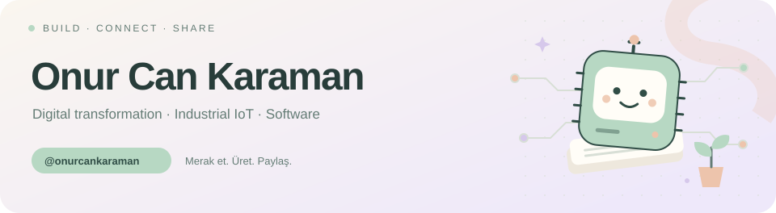

<picture>
  <source media="(prefers-color-scheme: dark)" srcset="assets/header-dark.svg">
  <source media="(prefers-color-scheme: light)" srcset="assets/header-light.svg">
  
</picture>

## Merhaba, ben Onur Can 👋

Dijital dönüşüm, **Industrial IoT** ve **IT/OT** üzerinde çalışıyorum. Burada geliştirdiğim araçları, denemelerimi ve eğitim notlarımı paylaşıyorum.

Fabrika verisiyle yazılımı buluşturmak, bir fikri çalışan bir araca dönüştürmek ve öğrendiklerimi paylaşmak ilgimi çekiyor.

### Çalışma masamdan

<table>
<tr>
<td width="50%" valign="top">
<h3>📖 <a href="https://github.com/onurcankaraman/folio-markdown">Folio</a></h3>

Markdown belgelerini kod bilmeden okumak ve düzenlemek için yerel çalışan bir masaüstü uygulaması.

<code>TypeScript</code> <code>React</code> <code>Electron</code>

</td>
<td width="50%" valign="top">
<h3>🌱 <a href="https://github.com/onurcankaraman/IoT1929">IoT1929</a></h3>

Arduino ve IoT derslerinden devre örnekleri, C++ kodları ve uygulama notları.

<code>Arduino</code> <code>C++</code> <code>IoT</code>

</td>
</tr>
<tr>
<td width="50%" valign="top">
<h3>🔧 <a href="https://github.com/onurcankaraman/gdg_hatay_sunum">GDG Hatay · Machine Learning</a></h3>

CNC testere aşınma tahmini üzerine atölye: veri analizi, model eğitimi ve API örnekleri.

<code>Python</code> <code>scikit-learn</code> <code>FastAPI</code>

</td>
<td width="50%" valign="top">
<h3>🔗 <a href="https://github.com/onurcankaraman/Nodered-MicrosoftAzureAnomalyDetection">Node-RED × Azure</a></h3>

Azure Anomaly Detector'ı Node-RED akışlarıyla kullanmak için bir örnek çalışma.

<code>Node-RED</code> <code>Azure</code> <code>Anomaly Detection</code>

</td>
</tr>
</table>

### Araç kutum

`Industrial IoT` · `IT/OT` · `Arduino` · `C++` · `Node-RED`  
`Python` · `TypeScript` · `React` · `Flutter` · `Unity`

---

  Küçük denemeler, işe yarayan araçlar ve paylaşılacak yeni şeyler. 
  <a href="https://github.com/onurcankaraman?tab=repositories">Tüm projelere göz at →</a>

